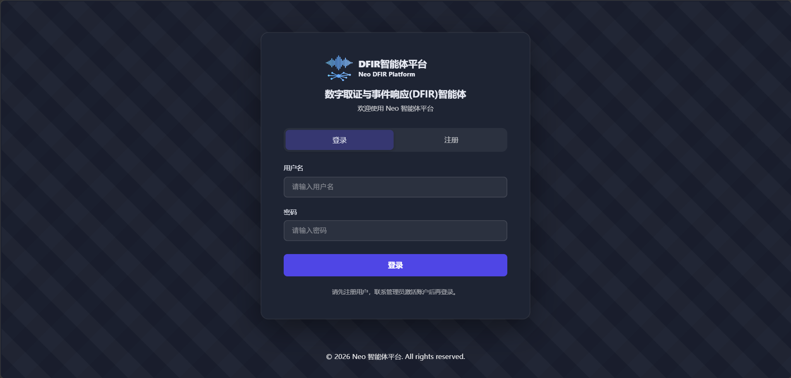
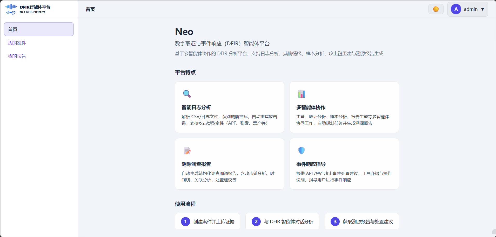
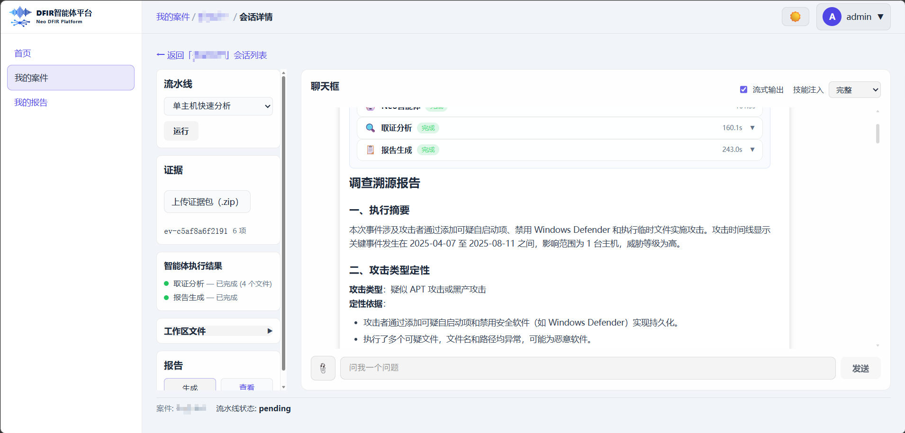
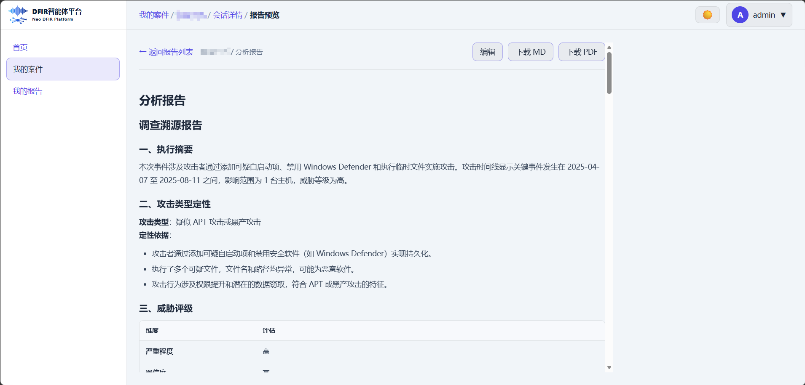

# Neo-DFIR-Agent-Platform

### 数字取证与事件响应（DFIR）多智能体分析平台

Neo 是一套面向 **数字取证与事件响应（DFIR）** 场景的多智能体 Agent 平台：在案件与证据上下文中，协调取证分析、样本研判、威胁情报查询与结构化报告生成，并通过 Web 控制台完成案件 / 会话 / 证据 / 报告的全流程协作。

它回答的问题不是「再做一个聊天机器人」，而是：

> 在约定的证据、工具与模型条件下，这条调查链路是否**可编排、可观测、可复盘、可交付**？

| 维度 | 说明 |
|------|------|
| **后端** | FastAPI + LangGraph Supervisor 多智能体编排 |
| **前端** | React + Vite 控制台（案件 / 会话 / 报告） |
| **能力** | 日志取证、样本分析、IOC 情报、Skills 渐进加载、SSE 流式输出 |
| **状态** | 实验室 / 研发可用 |

### 界面预览

| 登录 | 首页 |
|:---:|:---:|
|  |  |

| 会话分析 | 报告预览 |
|:---:|:---:|
|  |  |

---

## Why Neo?

- **🧩 多智能体分工。** Supervisor 按证据与意图委派取证 / 样本 / 报告 / 咨询子智能体，而不是单提示词包打天下。
- **📂 案件级上下文。** 证据入库、会话工作区、案件记忆（`.case_memory.md`）跨 Session 复用关键结论。
- **📡 可观测执行。** SSE 流式推送 token、工具调用与智能体阶段事件，便于联调与审计。
- **🧰 可扩展能力面。** 证据读写、样本静态/动态分析、威胁情报；可选 Skills 发现 / 路由 / 注入。
- **🖥️ 同一控制面。** WebUI 覆盖登录鉴权、案件协作、会话分析与报告预览 / 导出。

| 名称 | 含义 |
|------|------|
| **Neo**（本仓） | DFIR 多智能体分析平台（控制面 + 智能体运行时 + Web 控制台） |
| **Supervisor** | 唯一编排入口：通过 tool-calling 委派子智能体 |
| **Skills** | 可发现、可路由、可渐进加载的程序性知识（非 MCP 替代品） |

---

## Quick start

### 1. Prerequisites

- **Python 3.12+**（推荐 [uv](https://github.com/astral-sh/uv)）
- **Node.js 20+**（前端）
- **LLM**：OpenAI 兼容 API（见 `backend/.env.example`）
- **可选**：PostgreSQL（生产鉴权 / 持久化；本地测试可用内存存储）

### 2. 启动后端

```bash
cd backend
uv sync
# 复制并按需修改环境变量
# copy .env.example .env   # Windows
# cp .env.example .env     # Linux / macOS

uv run uvicorn src.main:app --host 127.0.0.1 --port 8000
```

| 入口 | 地址 |
|------|------|
| API | <http://127.0.0.1:8000> |
| Swagger | <http://127.0.0.1:8000/docs> |
| OpenAPI | <http://127.0.0.1:8000/openapi.json> |

### 3. 启动前端

```bash
cd webui
npm install
npm run dev
```

开发服务器会将 `/api`、`/health`、`/openapi.json` 代理到后端，**需先启动后端**。

默认账号（仅开发 / 测试）：

| 用户 | 密码 | 角色 |
|------|------|------|
| `admin` | `admin123` | 管理员 |
| `member` | `member123` | 成员 |

---

## Capabilities

Neo 将「证据 → 研判 → 报告」收成一条主路径：

1. **有证据时**  
   证据分类 → Supervisor 委派取证 / 样本分析 →（可选）情报 enrichment → 报告智能体整合输出  
2. **无证据时**  
   委派 DFIR 咨询智能体：IOC 威胁情报查询、事件响应建议与领域问答  

### 子智能体

| 智能体 | 职责 |
|--------|------|
| **Supervisor** | 路由与委派，汇总子结果 |
| **Forensic** | 日志 / 文本取证、IOC 提取、攻击链重建 |
| **Sample** | 样本静态 / 动态分析与关联 IOC |
| **Report** | 按模板生成调查溯源报告（含 Mermaid 等） |
| **Chat** | 无证据场景下的情报查询与 DFIR 咨询 |

### Skills（可选）

Skills 提供可复用的流程与检查清单：先短描述发现，命中后再加载 `SKILL.md` 正文注入上下文。配置示例见 `backend/config/skills_routing.example.yaml`；设计说明见 `docs/design/`。

---

## Repository layout

```
backend/                 # FastAPI 后端（API、鉴权、LangGraph、工具、Skills）
  src/agents/            # 子智能体与系统提示
  src/graph/             # StateGraph 编排与执行
  src/tools/             # 证据 / 样本 / 威胁情报等工具实现
  src/skills/            # Skills 发现、路由、注入
  config/                # 路由与运行配置示例
webui/                   # React + Vite 前端控制台
docs/design/             # 架构与改造方案
docs/prompt/             # 提示词参考稿
```

| 路径 | 职责 |
|------|------|
| `backend/` | 智能体运行时、HTTP API、鉴权与持久化适配 |
| `webui/` | 案件 / 会话 / 证据 / 报告 UI |
| `docs/design/` | Supervisor 架构、对话工具、Skills 框架等设计文档 |

---

## Build & test

```bash
# 后端测试（默认内存存储，无需 PostgreSQL）
cd backend
uv sync --extra dev
uv run pytest -v

# 前端构建
cd webui
npm run build
```

---

## Configuration

后端环境变量见 `backend/.env.example`（复制为 `.env` 后按需修改），主要包括：

- LLM：`OPENAI_*` / 兼容网关地址与模型名
- 鉴权：JWT 密钥、是否关闭鉴权（仅测试）
- 威胁情报：VirusTotal 等（可选）
- Skills：开关与路由配置路径

密钥与 Cookie **勿提交**仓库。

---

## Documentation

| 文档 | 用途 |
|------|------|
| [docs/design/Neo_智能体架构说明.md](docs/design/Neo_智能体架构说明.md) | 多智能体拓扑与状态 |
| [docs/design/Neo_Supervisor多智能体架构设计.md](docs/design/Neo_Supervisor多智能体架构设计.md) | Supervisor 编排细节 |
| [docs/design/Neo_Skills调用框架改造方案.md](docs/design/Neo_Skills调用框架改造方案.md) | Skills 发现 / 路由 / 注入 |
| [docs/design/Neo_对话功能与工具调用.md](docs/design/Neo_对话功能与工具调用.md) | 对话路径与工具触发 |
| [backend/README.md](backend/README.md) | 后端开发与测试说明 |

---

## Safety boundaries

1. 默认账号仅用于本地开发；生产环境须更换并关闭测试旁路。
2. 密钥、情报 Cookie、样本二进制不入库。
3. 分析结论须有证据或工具结果支撑；提示词要求不得编造缺乏依据的 IOC / ATT&CK 映射。
4. 高危样本分析应在隔离环境执行，本仓不提供在线投放能力。

---

## License

若仓库根目录包含 `LICENSE`，以其为准；未声明前仅供内部研发与联调使用。
